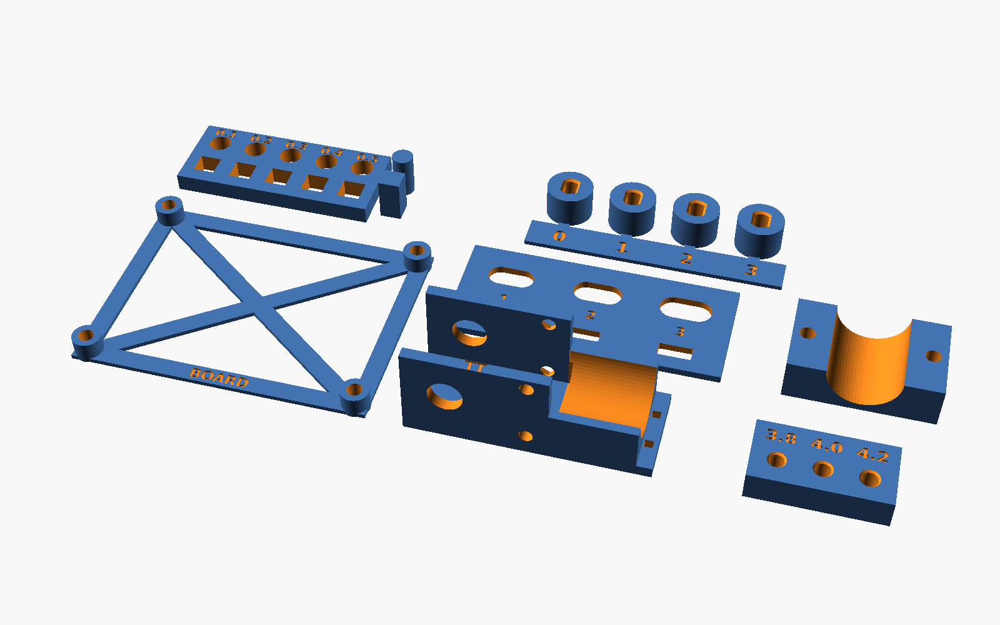

# Chassis (group G)

OpenSCAD sources for the printed body. Plain text, so every change shows up in a PR, and every dimension is a named parameter.

| File | What |
|---|---|
| [`params.scad`](params.scad) | Shared dimensions: printer clearances, M3 screws and heat-set inserts, the TT motor, 18650 cells, USB-C. Values marked `MEASURE` are best guesses until checked with calipers |
| [`board.scad`](board.scad) | Robot board outline and mounting holes as the chassis sees them. **Placeholder** until step F1 fixes the real board; nothing else hard-codes board dimensions |
| [`fit_test.scad`](fit_test.scad) | G1: the fit-test plate |
| [`render.sh`](render.sh) | Renders the plate and each piece to STL (in `out/`) |

CI renders the plate on every PR and attaches the STLs as the `chassis-stl` artifact of the run.

## G1: fit-test plate

One PLA print, about 4.5 h and 43 g (PrusaSlicer estimate with MK3 settings: 0.2 mm layers, 3 perimeters, 20 % infill). Everything lies flat on the bed and needs no supports. Print it with the stock PrusaSlicer **0.20mm QUALITY** profile for the MK3 and your PLA; for the hubs and the comb, 3 perimeters give truer holes than 2.

Use the whole plate (`fit_test.stl`) or single pieces (`fit_test_<piece>.stl`) if one needs a re-print.

### Before printing: measure the motor

The motor cradle and the hubs are built from TT motor dimensions found nowhere official; motors from different sellers differ by a millimetre here and there. With calipers on one of your motors, check the values marked `MEASURE` in `params.scad` (the comment on each line says what it is), most importantly:

1. Gearbox thickness along the shaft, face to face (`tt_body_t`, guess 18.8)
2. Gearbox height (`tt_gb_h`, guess 22.4) and length up to the can (`tt_gb_len`, guess 37.0)
3. Shaft centre from the gearbox end (`tt_shaft_x`, guess 11.2) and from the bottom edge (`tt_shaft_z`, guess 11.2)
4. The two mounting holes: distance of each centre from the gearbox end and from the bottom edge (`tt_holes`, guess 31.5 / 2.8 and 31.5 / 19.6), and their diameter
5. Shaft over the round part and across the flats (`tt_shaft_d` 5.4, `tt_shaft_flats` 3.7), and the hole in its end (`tt_shaft_hole_d` 2.0)
6. Can diameter and length (`tt_can_d` 20, `tt_can_len` 26)
7. Anything sticking out of the gearbox faces (a round boss around the shaft, a locating peg): where and how big

and your cells' diameter (`cell_d`, guess 18.6).

### The pieces and what to write down

| Piece | Tests | How | Write down |
|---|---|---|---|
| **Motor cradle** | Gearbox and can fit, M3 through-bolts line up with the motor's holes, shaft and boss clear the walls | Drop a motor in, bolt it with 2x M3 x 30 and nuts (the nuts go in the hex pockets) | Slides in by hand / too tight / loose; bolts go through without forcing; anything that rubs |
| **Wheel hubs** (4, on a tab marked 0-3) | D-bore clearance: 0.0, 0.1, 0.2, 0.3 mm | Snap them off, push each onto the shaft | The number of the tightest hub that still goes on by hand without wobble |
| | Screw into the shaft's centre hole | Screw a wheel screw (the one that came with the wheels) through the cap into the shaft | Does it hold the hub on? |
| **Insert block** (holes 3.8 / 4.0 / 4.2) | Heat-set insert hole size | Press one M3 insert into each with the soldering iron at about 220 °C for PLA, let it cool, screw an M3 in and pull | Which one sits straight, flush and doesn't spin or pull out |
| **Board frame** | The board hole pattern (placeholder until F1) and inserts in standoffs | Inserts in the 4 standoffs; lay the dev board, a printout of the board outline or a piece of cardboard on it | Standoffs straight, inserts hold |
| **Port wall** (2 mm, like the body wall) | USB-C plug openings 1: 12.5 x 6.5, 2: 13.2 x 7.0, 3: 14.0 x 7.6; switch slots 7 x 3, 8 x 3.5, 9 x 4 below them | Push your usual USB-C cable's plug through each opening | Smallest opening the plug passes; plug overmold width x height with calipers |
| **Cell seat** | 18650 diameter fit, inserts in a thin rib | Lay a cell in; inserts in the two holes | Cell drops in / snug / loose |
| **Tolerance comb** | Printed-to-printed clearance: round and square holes 6 mm + 0.1 to 0.5 | Push the loose round and square pins through each hole from the bottom | Smallest clearance each pin slides through by hand (sets `fit_slide`) |

Bring the numbers back (a photo of a note is fine); they go into `params.scad` and decide the dimensions of body v1 (G2).

### Why these choices

- **Cradle printed walls up, bolts through both walls.** Crash loads on the motor then pull across the walls, not along a layer line, and a through-bolt with a nut can't strip out of PLA. The can rests in a saddle so the gearbox doesn't carry the motor's weight alone.
- **Horizontal holes 0.2 mm larger** (`hole_extra`): the top of a horizontal hole is bridged and sags, so such holes come out small and slightly oval.
- **Labels are debossed 0.6 mm**, not raised, so they don't catch the nozzle and still read on the first layers above.
- **Zip-tie slots** behind the can anchor the motor leads, so pulling a wire doesn't load the solder tabs (see "Built for play" in `PLAN.md`).
